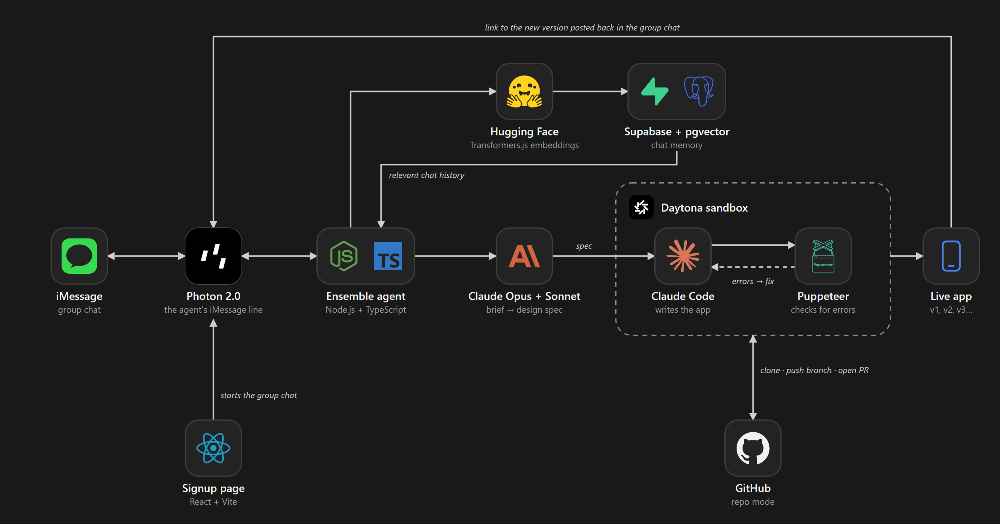

# Ensemble.

### The group chat that builds.

Ensemble is an AI coding teammate that lives in your iMessage group chat. Brainstorm with your friends, ask Ensemble to build something or continuing building something, with live previews and iteration available right in your hands. 

**Built at HackHarvard 2026 with Photon 2.0, Daytona, and Anthropic Claude.**

## Why Ensemble?

The best ideas start in group chats. Most of them stay there.

Whether your continuing building a startup, or working on a hackathon project across the world with your teammates, Ensemble lets you work together using the thing we all have without any setup: Our phones and text messages.

Ensemble gives the whole group a coding teammate. Everyone can contribute ideas, request changes, and try the result together—all from iMessage without ever leaving the conversation.

## How it works

1. **Create your group.** Use the signup page to start an iMessage group with your teammates and Ensemble.
2. **Share an idea.** Talk normally about it while Ensemble pulls context and simply call on it when you want to start building.
3. **Approve the plan.** Ensemble writes a brief. Reply **“ship it”** to start building.
4. **Open the result.** Ensemble builds the app in a Daytona sandbox and posts a live link.
5. **Keep improving it.** Ask for changes and get a new version, while earlier versions keep their own links over time.

> **You:** @Ensemble continue on from our previous PR on our project.  
> **Ensemble:** Here's the plan… Reply “ship it” to build it.  
> **Teammate:** ship it  
> **Ensemble:** v1 of the change is live!  
> **You:** @Ensemble fine tune the model to only take in the following requirements... 
> **Ensemble:** On it: v2…

## What you can do

- **Build together:** Create anything and continue anything at any time.
- **Make it personal:** Bring photos, names, and inside jokes into what you build.
- **Iterate through messages:** Describe changes naturally and receive an updated app all depending on your convos.
- **Keep your versions:** Revisit earlier builds through their original links.
- **Work on existing code:** Connect a GitHub repository, ask questions, and request changes through branches and pull requests and deployments.

## Photon 2.0: bringing the agent into iMessage

Photon powers Ensemble’s connection to the group chat. It delivers incoming messages and photos to our agent and sends plans, progress updates, and app links back to the conversation.

It also powers group creation through our signup page, so teammates can start building together without installing another messaging app.

**The conversation is the interface.**

## Daytona: turning ideas into working software

Daytona provides the isolated development environments where Ensemble builds.

Inside a sandbox, Ensemble can write code, install dependencies, run commands, and execute tests. Generated apps are served through Daytona preview links that the whole group can open.

Each published version gets its own link. For existing repositories, Daytona gives Ensemble a workspace to clone code, implement changes, and prepare commits and pull requests.

**The result is working software your group can actually try.**

## Claude: from conversation to code

Anthropic Claude turns the group’s ideas into a clear build brief and detailed design specification. Claude Code works inside Daytona to implement the app or repository changes.

The specification captures the details that make an idea yours: controls, visual style, behavior, photos, and references from the conversation.

Generated pages are checked for browser errors, with failures sent back for a repair attempt before the result is shared.

## Architecture

**iMessage → Photon → Ensemble → Claude → Daytona → live app → group chat**

Conversation memory helps Ensemble retrieve relevant context, while GitHub connects the workflow to existing repositories.

## GitHub, from your group chat

Ensemble can help with an existing project as well as build something new.

Ask it to explain the code, implement a feature, compare changes, or undo its work. Repository changes are prepared on branches and shared through pull requests for review.

Rollbacks create new commits rather than erasing history.

## Built with

| Technology | Purpose |
|---|---|
| **Photon 2.0** | iMessage messaging, photos, and group creation |
| **Daytona** | Isolated development environments and app previews |
| **Anthropic Claude & Claude Code** | Planning, design specifications, and implementation |
| **Node.js & TypeScript** | Backend and agent orchestration |
| **React, Vite & Tailwind CSS** | Signup page and frontend |
| **Motion & Three.js / React Three Fiber** | Animated frontend experience |
| **Supabase / PostgreSQL & pgvector** | Conversation storage and retrieval |
| **Hugging Face Transformers.js** | Local embeddings for conversation memory |
| **GitHub API & Git** | Repositories, branches, commits, and pull requests |
| **Puppeteer** | Browser checks for generated apps |
| **Sharp & heic-convert** | Photo processing and iPhone image support |

## Run locally

Requires **Node.js 20+**, Anthropic and Photon credentials, and a Daytona key for sandboxed builds and previews.

### Install dependencies

    npm install
    npm run web:install

### Configure your environment

    cp .env.example .env

Add your credentials and configuration to `.env`. Keep this file local and out of version control.

### Start the agent

    npm run dev

### Start the frontend

In another terminal:

    npm run web:dev

Open the local URL printed by Vite.

## Useful commands

| In the chat | What happens |
|---|---|
| `@Ensemble make a game where…` | Creates a build plan |
| `ship it` | Approves the pending plan |
| `@Ensemble add sound` | Requests a change to the current app |
| `@Ensemble versions` | Lists app versions or repository branches |
| `@Ensemble cancel` | Cancels a pending plan |
| `@Ensemble help` | Explains what Ensemble can do |

## What's next

We want faster builds, stronger automated checks, richer apps, and smoother collaboration across multiple projects and messaging platforms.

The goal stays the same: make building together as natural as talking about an idea.

---

**Ideas belong to the whole group. Building them should, too.**

**Ensemble. — Build Together.**
