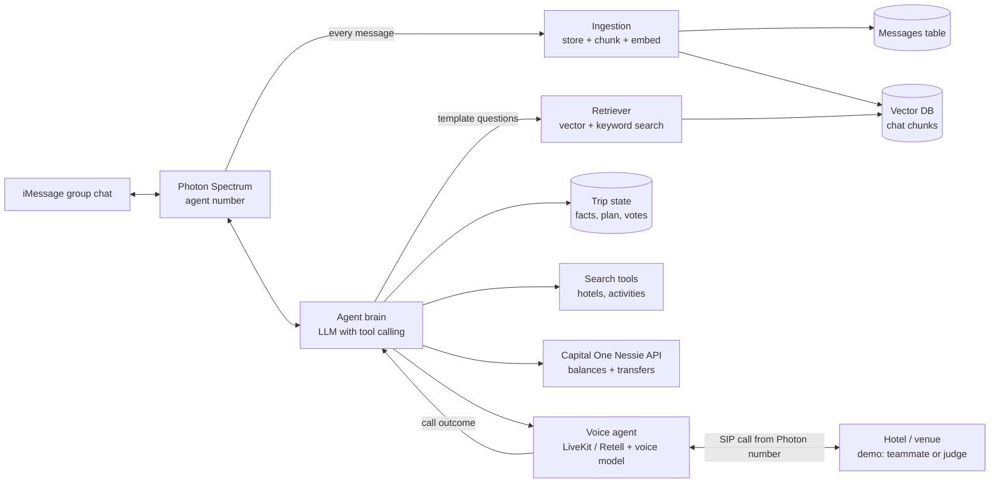

# Tripchat 🧳 *(working name)*

> An AI travel agent that lives in your group chat. It remembers everything the group has said about the trip, plans a trip everyone agrees on, calls hotels to book it, and splits the bill.

**HackHarvard 2026 · Oct 16–18 · Cambridge, MA**
**Team:** wiloz · Hetarth · Harsh · Matias

---

## TL;DR

Group trips die in the group chat. Everyone says "we should go somewhere," nobody books anything, and one person ends up fronting all the money.

Tripchat is an agent with its own phone number. It joins your iMessage group chat through **Photon**. It stores the conversation as **embeddings in a vector database**, so it can find what anyone said about dates, places, budgets, or preferences, even weeks later. From that memory it proposes a plan the group votes on, then **places real phone calls** to make the reservations. Finally, it uses **Capital One's Nessie API** to collect everyone's share into one payer's account.

---

## Target prizes

| Prize | Requirement | How we hit it |
|---|---|---|
| **Photon: Build a Messaging Agent with Photon 2.0** (main) | Built on Photon 2.0, live on at least one Photon channel. Most creative and technically impressive agent wins | Agent lives in an iMessage group chat through Photon, with long-term RAG memory of the conversation |
| **Photon: Best voice agent** | Best voice agent on a Photon phone number | The same Photon number places outbound calls to hotels and venues |
| **Capital One: Best Use of Nessie** | Real use of the Nessie API | Sets the budget from balances and automatically pools transfers to the payer |
| **Best Overall** | — | Full loop in the demo: chat → memory → plan → live call → money moved |

**Not targeting:** SpaceXAI "Make It Legendary." It requires real space data, Cursor, and Grok Imagine/Voice, and a travel app doesn't fit. Grok Voice is still an option for the voice engine.

---

## The problem

- Trip planning in a group chat is chaos. Availability, preferences, and budgets are buried across hundreds of messages.
- One person ends up doing all the research, calling, and booking.
- One person fronts the money, then chases payment requests for weeks.
- Many bookings still need a phone call: group rates, small hotels, special requests, and places with no online booking.

---

## How it works (user flow)

1. **Join.** Someone adds the Tripchat number to the group chat. That's the opt-in. The agent posts a short intro explaining what it remembers and how to wipe it.
2. **Remember.** It backfills every message its line can see, then ingests each new message live. Messages are grouped into conversation chunks, embedded, and stored in the vector DB.
3. **Plan on request.** Someone texts `@Tripchat plan it`. The agent runs a **template of retrieval questions** (availability, destination, budget, constraints, and so on) against the vector DB. It pulls the most relevant passages and extracts a structured picture of what each person wants.
4. **Check budget.** It pulls each member's Nessie balance so the options are realistic for *everyone*, not just whoever has the most money.
5. **Propose.** It replies with 2–3 options and cites who said what ("Dec 19–22, since Harsh is busy until the 18th").
6. **Vote.** The group reacts or replies to pick an option. The agent confirms each step in chat before acting.
7. **Book by phone.** The agent calls the hotel (or restaurant, tour, or rental desk) from its Photon number, using the retrieved details (names, room count, special requests). It makes the reservation and posts the confirmation back to the chat.
8. **Split.** One person is the designated payer. Each member approves their share in chat, then the agent transfers it to the payer's account through Nessie.

Anyone can also ask it free-form questions anytime: `@Tripchat what did Matias say about the Airbnb?`

**Pay at property:** the agent only holds reservations, and the group pays on arrival. Nobody ever hands a card to the AI.

**Beyond travel:** the same loop works for restaurants, amusement parks, rental cars, and group events.

---

## Architecture



### Components

| Component | Job | Notes |
|---|---|---|
| **Photon Spectrum** | Gives the agent a phone number and iMessage presence, and streams inbound messages to us | `spectrum-ts`. The Advanced iMessage kit adds `listInChat` for paging through stored history. Docs: docs.photon.codes |
| **Ingestion** | Saves raw messages, groups them into chunks, and embeds the chunks | Runs on every inbound message (debounced) plus a backfill on join/startup |
| **Vector DB** | Stores chunk embeddings and metadata | **Supabase + pgvector** (recommended: messages, vectors, and trip state in one Postgres) or Chroma for the fastest local start |
| **Embedding model** | Turns chunks and queries into vectors | Any embedding API, or local `sentence-transformers` (free, no rate limits) |
| **Retriever** | Runs the question template, merges results, expands context | Vector search, plus keyword search for dates, prices, and names |
| **Agent brain** | Extracts trip facts, plans, and decides when to call tools | Any LLM with tool calling. Tools: `retrieve_context`, `get_trip_state`, `search_options`, `get_balances`, `place_call`, `request_approvals`, `transfer_shares` |
| **Trip state** | Structured facts and plan for each group chat | Members, availability, preferences, budget, chosen plan, approvals, with source message IDs |
| **Voice agent** | Places outbound reservation calls and reports the outcome | Photon routes calls to SIP platforms like LiveKit and Retell. The voice model is swappable (Grok Voice has a LiveKit plugin) |
| **Nessie** | Budget and money movement | Sandbox only: fake customers, fake money |
| **Search** | Finds hotels and activities | Hackathon shortcut: a curated JSON of options for the demo city, plus one live search API if time allows |

---

## Chat memory (RAG)

### ⚠️ What history we can actually get

**iMessage doesn't show a new group member the messages sent before they were added.** That includes our agent's line, so "pull the whole chat history on join" only covers messages the line itself has seen. Plan around that:

| Source | What it covers | Status |
|---|---|---|
| **Live stream** | Every message after the agent joins | MVP |
| **Backfill with `listInChat`** | Everything the agent's line has stored, including messages missed while our backend was down. Run it on join and on every restart | MVP |
| **Demo setup** | Create the demo group chat *with the agent in it from the start*, then seed a realistic day of trip talk | MVP |
| **Mac history import** | A member runs a script on their Mac to export older history (Photon's open-source `imessage-kit` can query the local Messages database) | Stretch, and only with the whole group's OK |

### 1. Ingestion

- **Store raw messages first** (`messages` table): guid, chat_id, sender, sender_name, text, sent_at, reply_to. Embeddings can always be rebuilt from this table.
- **Chunk by conversation window, not by single message.** A text like "same" or "im down" means nothing alone. Build chunks from consecutive messages:
  - Start a new chunk after a time gap of about 45 minutes, or once a chunk hits about 15 messages.
  - Overlap 3 messages between chunks so replies keep their context.
  - Format each chunk as transcript lines: `[Dec 3, 8:14pm] Harsh: I'm free after the 18th`.
- **Metadata on each chunk:** chat_id, message_ids, participants, start_at, end_at.
- **Live updates:** append new messages to the open chunk, and re-embed it when it closes (gap or size limit) or when someone triggers a plan.

### 2. Retrieval with question templates

When someone triggers a plan, the brain fills slots from the request (destination, dates, trip type) into a fixed template of questions. Each question is searched separately, along with the raw request itself.

| Slot | Template question |
|---|---|
| `availability` | When is each person free or busy {around {dates}}? |
| `destination` | Where does everyone want to go, and which places were ruled out? |
| `budget` | How much is each person willing to spend? Any money concerns? |
| `lodging` | Hotel, Airbnb, or hostel? Room-sharing preferences? |
| `activities` | What does everyone want to do on the trip? |
| `constraints` | Dietary restrictions, allergies, accessibility, or anything someone can't do? |
| `logistics` | Where is everyone traveling from? Who has a car or is driving? |
| `commitment` | Who's in, who's out, and who's a maybe? |
| `request` | *(the user's message, as-is)* |

**Retrieval steps:**
1. Embed each question and take the top 5 chunks from this chat (cosine similarity).
2. Also run a **keyword search** (Postgres full-text) for exact dates, prices, and names. These embed poorly, so the keyword pass catches "Dec 19" or "$300" when vectors miss them.
3. Merge results, remove duplicates, and add the neighboring messages of each hit.
4. **Sort chronologically and treat the latest statement as the truth.** People change their minds ("actually I can't do the 20th anymore"), so the extraction prompt must say later messages override earlier ones.

### 3. Extraction → trip state

The LLM reads the retrieved passages and fills a structured `TripContext`. Every fact keeps its source message IDs, so the agent can cite who said what:

```json
{
  "members": {
    "Harsh": {
      "status": "in",
      "available": ["2026-12-19/2026-12-23"],
      "budget_max_usd": 400,
      "wants": ["skiing", "night out"],
      "constraints": ["vegetarian"],
      "sources": ["msg_guid_12", "msg_guid_88"]
    }
  },
  "destination_candidates": ["Montreal", "Vermont"],
  "ruled_out": ["Miami"],
  "lodging_pref": "one Airbnb or 2 hotel rooms",
  "open_questions": ["Matias hasn't confirmed dates"]
}
```

The planner uses `TripContext` plus Nessie balances to build options. The voice agent gets the relevant slice too (names, room count, late check-in, dietary needs), so it doesn't ask the hotel generic questions.

### 4. Schema (pgvector)

```sql
create extension if not exists vector;

create table messages (
  id          text primary key,     -- iMessage guid
  chat_id     text not null,
  sender      text,
  sender_name text,
  body        text,
  sent_at     timestamptz not null
);

create table chunks (
  id          bigserial primary key,
  chat_id     text not null,
  content     text not null,         -- transcript lines
  message_ids text[] not null,
  start_at    timestamptz,
  end_at      timestamptz,
  embedding   vector(1536),          -- match your embedding model's dimension
  fts         tsvector generated always as (to_tsvector('english', content)) stored
);

create index on chunks using hnsw (embedding vector_cosine_ops);
create index on chunks using gin (fts);
```

```sql
-- vector search
select content, start_at, 1 - (embedding <=> $1) as score
from chunks
where chat_id = $2
order by embedding <=> $1
limit 5;

-- keyword search
select content, start_at
from chunks
where chat_id = $1 and fts @@ websearch_to_tsquery('english', $2)
limit 5;
```

### Why RAG and not "just paste the whole chat into the prompt"?

A demo chat of a few hundred messages would fit in one prompt. A real friend group chat has months or years of messages, so RAG is what makes this work outside the demo. It also keeps each LLM call fast and cheap, and lets the agent cite exact messages.

---

## Nessie plan

- **Setup:** create one sandbox customer and checking account per teammate, and seed the balances. Write a reset script so every demo starts clean.
- **Budget:** `GET /accounts/{id}` for each member gives their balance. The per-person cap is the lower of their balance-based cap and any budget they stated in chat (from RAG).
- **Pool:** once every member has approved, call `POST /accounts/{member_account_id}/transfers` for each member, with the payer's account as `payee_id`, `medium: "balance"`, and their share as `amount`.
- **Show it:** display balances before and after, plus `GET /accounts/{id}/transfers`, during the demo.
- The API key goes in the `key` query param. **Confirm exact paths and fields in the Nessie Swagger docs.**

---

## Agent rules (bake into the system prompt)

- Never move money or book anything without an explicit confirmation in the group chat.
- Every member must approve their own share before their transfer runs.
- On every call, open by saying it's an AI assistant booking on behalf of a group.
- If the venue says something unexpected (sold out, price change), check back with the group instead of guessing.
- When facts conflict, trust the most recent message, and ask if it's still unclear.
- Support `@Tripchat forget`, which deletes this chat's messages, chunks, and trip state.

---

## Demo script (~3 min)

| Time | Beat |
|---|---|
| 0:00 | **Hook:** "Raise your hand if a group trip has died in your group chat." |
| 0:15 | Show the group chat on a phone mirrored to the screen, pre-seeded with a realistic day of messy trip talk, including someone changing their dates halfway through. |
| 0:30 | Someone texts `@Tripchat plan it`. The agent replies with dates that work, the destination, and a budget based on chat + Nessie, and cites who said what. It catches the date change. |
| 0:50 | **Memory flex:** on the laptop, show a small debug view of which passages each template question pulled. |
| 1:05 | The group votes with reactions, and the agent confirms the plan. |
| 1:15 | The agent texts "Calling the hotel to hold 2 rooms." **A judge's phone rings**, or a teammate plays the front desk on speaker. The agent asks for rooms, dates, a group rate, and late check-in, all pulled from the chat. |
| 1:45 | *(Stretch)* **Curveball:** the front desk says only one room is open Friday. The agent texts the group mid-call ("Only 1 room Friday. OK to upgrade to a suite for +$40?"), gets a reply, and finishes the booking. |
| 2:15 | The confirmation lands in the group chat. |
| 2:30 | Each member approves their share, the Nessie transfers run, and the balances update live. |
| 2:50 | **Close:** "Hotels today. Restaurants, amusement parks, and rental cars tomorrow. Any reservation, from the chat you're already in." |

**Backup:** record a clean run of the full demo, including the call, Saturday night in case the Wi-Fi or phone fails.

---

## Judge Q&A prep

**"Why call instead of booking online?"**
Many small hotels, tours, and restaurants don't take online bookings, or their online inventory is limited. Group rates, adjoining rooms, accessibility needs, and late check-in usually need a person. Calling is also the step nobody in the group wants to do.

**"Where does the money come from?"**
Reservations are pay-at-property, so nothing is charged at booking. Nessie pools each person's share into the designated payer's account, so nobody fronts the whole trip or chases payments.

**"Why RAG?"**
Real group chats are far too long for one prompt. Retrieval keeps calls fast, finds the one message from three weeks ago where someone said they're vegetarian, and lets the agent cite its sources.

**"Is it creepy that it remembers our chat?"**
It's opt-in: it only joins when someone adds it, and it says what it stores. It only acts on trip context, never books or moves money without confirmation, and `@Tripchat forget` wipes everything.

**"Isn't this like Yumi from last year?"** See below.

---

## How we're different from Yumi (HackHarvard 2025, 3rd Best Overall)

| | Yumi | Tripchat |
|---|---|---|
| **Where it lives** | Its own iOS app and web dashboard | Inside the group chat you already use. Nothing to download |
| **Input** | Users write reviews and ask it for recommendations | Remembers the group's conversation through RAG |
| **Scope** | Restaurants | The whole trip: lodging, activities, rentals, dining |
| **Action** | Recommends places | Books by phone and collects the money |
| **Voice calls** | Listed as a future idea | Core feature, live in the demo |
| **Track** | Overall only | Photon + Capital One + Overall |

---

## MVP vs stretch

**MVP (must ship)**
- [ ] Photon agent sends and receives in a real iMessage group chat
- [ ] Every message saved to the `messages` table, plus a backfill with `listInChat` on join and restart
- [ ] Chunking and embeddings into pgvector
- [ ] Template retrieval → `TripContext` extraction with source citations
- [ ] `@Tripchat plan it` returns options using chat context and Nessie balances
- [ ] Group confirmation flow in chat
- [ ] Outbound call from the Photon number that completes a reservation and reports back
- [ ] Per-member approval, then Nessie transfers to the payer
- [ ] `@Tripchat forget`
- [ ] Demo seed and reset script (group chat + Nessie)

**Stretch**
- [ ] Keyword search alongside vector search
- [ ] Retrieval debug view for the demo
- [ ] Free-form Q&A over the chat (`@Tripchat what did X say about Y?`)
- [ ] Mid-call check-in with the group (the curveball demo)
- [ ] Mac history import with group consent
- [ ] Live hotel or activity search instead of curated data
- [ ] Multiple bookings in one plan (hotel + dinner + activity)

---

## Team & timeline *(suggested, adjust)*

| Person | Owns |
|---|---|
| **wiloz** | Backend + Nessie (seed, budget, transfers) |
| **Matias** | Photon agent + ingestion + RAG (chunking, embeddings, retrieval) |
| **Hetarth** | Voice agent + demo call |
| **Harsh** | Planner + options data, pitch, Devpost, video |

| When | Goal |
|---|---|
| **Fri night** | Hello world on every piece: the agent replies in a test group chat and saves messages to the DB, the Nessie seed script runs, the voice agent places one outbound call |
| **Sat morning** | Chunking, embeddings, and template retrieval working. `TripContext` extraction. Nessie budget and transfers wired in. Call script reports the booking result back |
| **Sat afternoon** | **Full end-to-end loop working.** Seed the demo group chat |
| **Sat night** | Polish, rehearse the demo 3+ times, record the backup video |
| **Sun morning** | README, Devpost, final video, **submit early** (check the official deadline) |

---

## Submission checklist

- [ ] Devpost submission with the Photon and Capital One challenges selected
- [ ] Demo video
- [ ] Public GitHub repo
- [ ] README explains where Photon is used (channel + number), where Nessie is used, and how the RAG pipeline works
- [ ] Agent live on at least one Photon channel during judging
- [ ] Demo reset script tested

---

## Open questions

- Final name (the GC name?)
- Demo city and dates
- Which LLM runs the brain, which embedding model to use, and which voice model runs the calls
- Confirm early that group messages show up in the stream as expected (test with a 3-person chat tonight)
- How the payer is chosen: a volunteer, or whoever's card holds the booking

---

## Links

- Photon docs: https://docs.photon.codes
- Photon message history (`listInChat`): https://photon.codes/docs/advanced-kits/imessage/messages
- pgvector: https://github.com/pgvector/pgvector
- Nessie API: http://api.nessieisreal.com
- Yumi (last year): https://devpost.com/software/yumi
- Grok Voice docs (optional voice engine): https://docs.x.ai/developers/model-capabilities/audio/speech-to-speech
